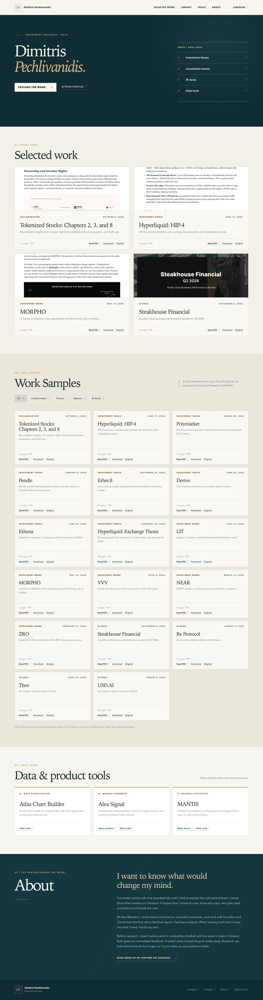

# Dimitris Pechlivanidis — research portfolio

A static, PDF-first portfolio prepared for GitHub Pages. The public site is in
`docs/`; the source-to-PDF builders are in `scripts/`.



## Preview

```bash
python3 -m http.server 8765 --directory docs
```

Open `http://localhost:8765/`. The site itself has no build step, framework,
cookies, or analytics.

## Rebuild PDFs and index

Install the packages in `requirements.txt`. Install Playwright Chromium with
`python3 -m playwright install chromium`, or set `PORTFOLIO_CHROME` to a local
Chrome executable. On macOS, the scripts use `/Applications/Google Chrome.app`
when present.

```bash
python3 scripts/build_articles.py
python3 scripts/build_redstone.py
python3 scripts/build_decks.py
python3 scripts/build_personal.py
python3 scripts/build_stacks.py
python3 scripts/build_quarterly_exports.py
python3 scripts/build_circle_model.py
python3 scripts/optimize_pdfs.py
python3 scripts/build_site.py
python3 scripts/check_site.py
```

The scripts fetch the public source pages. Article PDFs reformat the published
text and figures, retain outbound source links, and add a personal cover with
the original publisher and date. They do not update old market views. The
RedStone PDF includes chapters 2, 3, and 8, each credited to Dimitris on the
source page. Deck PDFs capture every slide from the public Figma audience
view; their slide pages are high-resolution images, so the original deck link
remains available alongside the PDF.

The personal Tokenized Stocks report is rebuilt from
`source-pdfs/tokenized-stocks-original.pdf`, which stays local and is excluded
from Git. Restore that private source file before running `build_personal.py`.
The published edition adds `@demetriusweb3` in the footer and a light chart
watermark, and removes two old Alea template marks from chart footers. Its
September 30, 2026 date is a data cutoff, not a publication date.

The Stacks Q3 2026 benchmark is rebuilt from
`source-pdfs/stacks-q3-2026-export.pdf`, a local export of the author-supplied
Google Doc. The source stays out of Git. `build_stacks.py` adds a portfolio
cover that credits Dimitris and Alea Research. All 50 report pages, links,
and the commissioned-research disclosure remain in the public PDF. The card
uses the reporting quarter rather than claiming a publication date, and it
does not link to the private Google Doc.

The State of Crypto ETFs and Robinhood Chain Q3 2026 reports are rebuilt from
`source-pdfs/crypto-etfs-q3-2026-export.pdf` and
`source-pdfs/robinhood-chain-q3-2026-export.pdf`. These are author-supplied
Google Docs exports kept out of Git. `build_quarterly_exports.py` adds a cover
under Dimitris's name while preserving every report page and source link. The
cards show the reporting quarter and do not expose the Google Doc edit links.

The independent Circle financial model is copied without changes from
`source-pdfs/circle-financial-model-original.pdf` by `build_circle_model.py`.
That local source is excluded from Git. The public PDF retains its embedded
workbook; there is no separate `.xlsx` download on the site.
The script checks the reviewed source hash, page count, date, and attribution.

`docs/data_rooms.json` supplies the Data Rooms category, which appears after
Financial Models. Its six cards link to the live Tempo, Aave, Hyperliquid, Morpho,
Polymarket, and Derive rooms. Tempo through Polymarket currently require a
sign-in; Derive opens directly. Room cards are web links, not PDF exports.

## Publishing

The intended GitHub Pages repository is `0xDimi/0xDimi.github.io`, with `docs/`
as the branch publishing source. Review the
PDFs, site copy, and publication rights before pushing them to a public repo.

## Attribution

Alea Research retains its credit on the Alea reports and decks. The RedStone
report credits Dimitris as a core contributor and names him on chapters 2, 3,
and 8. Portfolio covers identify the original publisher and link to the
canonical publication. The personal Tokenized Stocks report is labeled as
independent work and has no Alea source link. This portfolio does not imply
sole authorship of team research.
